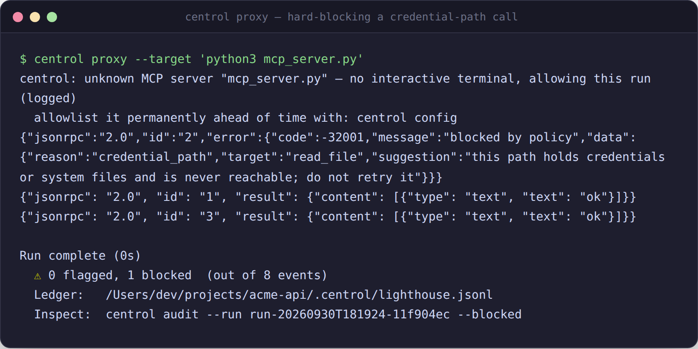
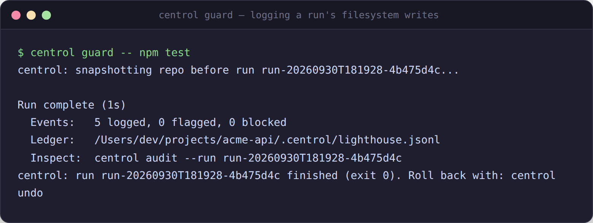
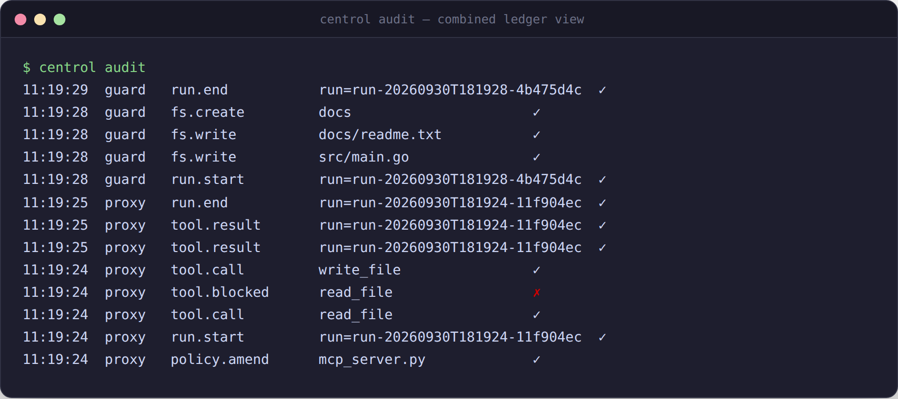

# centrol


Centrol: The Independent Flight Recorder for AI Agents

 A local-first accountability layer for coding agents (Claude Code, Cursor, Windsurf, or anything else you run from a terminal or point at an MCP server). 
 
When you let an AI agent work on your machine — running commands, editing files, calling tools — the only record of what it did is usually the agent's own log. But if an agent goes off the rails, its own log is the one thing you can't trust, because the agent wrote it about itself.

Centrol sits completely outside the agent. It writes an independent, tamper-evident record that the agent cannot alter without detection. When something goes wrong, you can see what actually happened and prove it — to a teammate, a reviewer, or anyone who wasn't watching — without asking anyone to take the agent's word for it. 

This gives you the management, insight, and visibility you're missing — through a truth ledger you can use to assess decisions, direction, stages, and deviations, and to build confidence and trust in your agents.

AI is a black box. Centrol clears the ambiguity.

Eliminate agent blind spots before they catch up to you.

Free. Runs entirely on your machine. No cloud, no account, no telemetry. Nothing leaves your computer.

Centrol covers the paths agents act through — the filesystem, MCP tool calls, shell, and outbound network. It logs everything it sees to an append-only, hash-chained ledger you can review, verify, and roll back, and it blocks what violates policy on the path where blocking is possible.

## The proxy is the part that acts
The record tells you what happened. The proxy is what changes what's allowed to happen.
It sits between your agent and every MCP server it talks to. Every tool call passes through it before anything executes — that's where allowlists and blocks happen. A call that violates policy doesn't run. It gets recorded as having been refused.
That's the difference between watching and governing. You decide what's allowed, once. The proxy enforces it on every call, without you being in the loop each time.
Setup is one command. centrol proxy install <client> rewrites your MCP config so every server launches through the proxy. You run it once. After that it's automatic — no wrapper around your agent, no changes to your servers, nothing to remember before you start a session. It backs up your original config first, and it's safe to re-run: anything already wrapped is left alone.
What you get day to day:
•	A gate that runs whether you're watching or not
•	A record of both what ran and what was refused
•	The ability to loosen or tighten access without touching your agent or your servers
•	Nothing left running when you're not — no daemon, no service, no port

## guard is what you run agents under
There's no reason not to. Guard doesn't slow the agent down, change what it does, or add a step to your workflow — you run the same command with one word in front, and the run is recorded.
Two things happen when it starts. Every action gets recorded out-of-band — commands, file mutations, tool calls — so there's a record independent of the agent's own. And a snapshot is taken, so whatever the run produces, there's a state to return to.
When it goes sideways, you have the record of what happened and centrol undo to get back to before it started. When it doesn't, you still have the record — which is the part you'll want three weeks from now when you're trying to remember what an agent actually did.
Guard and undo are one workflow. Guard takes the snapshot; undo is how you get back to it. Run something under guard and you can reverse it. 

## Undo doesn't mean "revert everything"
Most rollback tools work the same way: restore the snapshot, lose whatever happened since. That's fine if the only thing that changed was the agent's work. It's a problem if you also touched something while the agent was running.
Centrol's undo is scoped to what the agent did. Your own work in progress is left alone.
Here's how it goes. You run the rollback, it confirms the restore succeeded, and then it shows you what the snapshot didn't have — the files and paths that appeared while the agent was running. Those are the ones the rollback couldn't account for, so it doesn't guess. It lists them, and you decide: keep, delete, move, whatever's right for that file.
Nothing is destroyed on your behalf. The decision stays with you.
That matters more than it sounds. If undo could silently eat an hour of your own work, you'd never reach for it — which means the agent's changes would just stay there. Undo is only useful if it's safe to run. This one is, because it hands you the list instead of making the call.
centrol undo --list shows what snapshots exist. centrol undo --from <id> restores a specific one instead of the most recent.


## How it works 
| Command | What it does |
|---|---|
| `centrol proxy install <client>` | One-command setup. Rewrites your MCP config so every server launches through the proxy automatically. Do this once and it runs on every subsequent call. |
| `centrol proxy` | Puts the MCP gateway in front of your servers — the main channel an agent uses — so you can monitor and control access through allowlists. |
| `centrol guard` | Run an agent you don't fully trust under guard. Every action is recorded out-of-band, and a snapshot is taken before it starts so you can roll back afterward. |
| `centrol undo` | Restores state to the last snapshot, with full provenance in the ledger showing what changed and why. |
| `centrol undo --list` | Shows a list of historical snapshots available to revert to. |
| `centrol undo --from <id>` | Restores a specific snapshot by ID instead of the most recent one. |
| `centrol audit` | Opens the historical ledger so you can read back exactly what an agent did. |
| `centrol audit --verify` | Runs a hash-chain integrity check across every segment of the ledger. No network required — verification is entirely local. |
| `centrol scope +<path>` | If you've set restrictions on a run and need to widen them, this opens the scope to allow a path for that run only. |
| `centrol status` | Current health check: the active run, its contract, and ledger integrity. |
| `centrol config` | Interactive menu for allowlists, gates, and thresholds. |


## See it in action 

`centrol proxy` hard-blocking a tool call that reaches for a credential
path, before it ever touches the target MCP server:



`centrol guard` wrapping a run — snapshot first, then every filesystem
write logged as it happens:



`centrol audit` — the combined ledger, allowed and blocked events side
by side:



## Install

centrol runs on macOS, Linux and Windows (amd64 and arm64). The install
is two static binaries, no dependencies: `centrol`, and `centrol-verify`,
the standalone reference verifier. Each script downloads both release
assets for your platform, checks each against the release's
`SHA256SUMS`, and only then installs them together.

macOS and Linux (installs to `/usr/local/bin`; override with
`CENTROL_INSTALL_DIR`; uses `sudo` only for the final move, and only if
that directory is not writable by you):

```sh
curl -fsSL https://raw.githubusercontent.com/baitelmal/centrol/main/install-centrol.sh | sh
```

Windows, in PowerShell (installs to `%LOCALAPPDATA%\Programs\centrol`, a
per-user directory, so no administrator rights; override with
`$env:CENTROL_INSTALL_DIR`; it prints the command to add the directory
to your PATH if it is not already there):

```powershell
irm https://raw.githubusercontent.com/baitelmal/centrol/main/install-centrol.ps1 | iex
```

The canonical repository, and the only install path, is
`github.com/baitelmal/centrol`: releases, checksums and the install
script all live there. The Go module is declared as
`github.com/scirem/centrol`; that is an import path used inside the
source tree and has no effect on installing.

## Quickstart

```sh
# Wrap an interactive agent session; nothing to configure first.
centrol guard -- claude

# Or front a stdio MCP server so its tool calls get logged and policy-checked.
centrol proxy --target "npx @modelcontextprotocol/server-filesystem /path/to/allow"

# Or front an HTTP MCP server the same way.
centrol proxy --target-url "https://mcp.example.com/sse"

# See what happened.
centrol audit

# Confirm the record hasn't been tampered with.
centrol audit --verify

# Undo the most recent run's changes.
centrol undo
```

No flags are required for the common case. `centrol guard -- <command>`
snapshots your repo, watches it while `<command>` runs, and lets you roll
back with `centrol undo` afterward.

## Coverage matrix

| Action             | guard | proxy | notes                |
|--------------------|:-----:|:-----:|-----------------------|
| File write          | flag  |   -   | logged; never blocked |
| MCP tool call        |   -   | yes   | validated, logged, hard-blocked when denied |
| Direct shell         | log   |   -   | not intercepted       |
| Network (non-MCP)    | log   |   -   | not intercepted       |


This is an accountability layer, not a sandbox. It records and reverses
governed actions. It does not prevent a determined agent from acting
outside the governed interfaces.

**guard and proxy enforce differently — this is deliberate, not a gap:**
`centrol guard` never blocks a filesystem write, not even one to a
credential path (`~/.ssh`, `~/.aws`, `/etc`, ...) — it logs every
out-of-scope or protected-path write as `policy.violation` and lets it
through, because a filesystem watcher observes writes after they've
already landed on disk; there's nothing left to block. `centrol proxy`
is different: it sits in front of the call *before* it reaches the MCP
server, so a tool call that resolves to a protected path is genuinely
never forwarded — the caller gets a structured denial instead (see
"Policy denials" below). If you need a hard guarantee that a credential
path is never touched, that guarantee exists on the proxy path, not the
guard path.

Making the guard automatic (optional)
The guard is per-session by design — it needs a start and end boundary so undo has something to restore to. If you want every invocation of an agent to be guarded, add a shell alias. This is a user-side convenience; the tool doesn't install it for you. 

macOS / Linux (in ~/.bashrc or ~/.zshrc):

_alias claude='centrol guard -- claude'_


Windows (in $PROFILE, the PowerShell profile):

_function claude { centrol guard -- claude @args }_

After adding, reload your shell (source ~/.bashrc or restart PowerShell). To skip the guard for a single invocation, use the raw binary (\claude on Mac/Linux, claude.exe on Windows).


## Detection and verification

Centrol's ledger is hash-chained and verifiable by anyone using
`centrol-verify` (a standalone binary that does not depend on Centrol).
While the tool is running, any external modification to `.centrol/`
ledger files is detected and logged as a `policy.tamper_detected`
event.

Limit: detection works while the tool is running. 

## Reference verifier: `centrol-verify`

`centrol-verify` is a standalone program that checks a ledger's hash
chain. It imports nothing from the centrol module — not the ledger
package, not the governor — so it re-derives the hashing rule from
`schemas/event.v1.json` rather than trusting the code that wrote the
ledger. The point is that you can check a ledger without trusting, or
even building, the binary that produced it: two independent
implementations agreeing is stronger than one checking itself.

It accepts a ledger from any tier. 
```
centrol-verify <path-to-lighthouse.jsonl>
centrol-verify <path-to-.centrol-directory>
centrol-verify --first-seq N <path>
```

A file is verified as one segment. A directory is verified as one
continuous chain across a ledger's rotated segments. Exit codes: `0`
valid, `1` chain broken (it reports the first failing sequence number
and why), `2` could not read the input.

Download `centrol-verify` from the release assets:
`centrol-verify-<os>-<arch>` (`darwin`, `linux` or `windows`; `amd64` or
`arm64`; Windows assets end in `.exe`).
The install script fetches it and checks it against the release's
`SHA256SUMS`; if you download it by hand, check it yourself.

The first entry must be seq 1 with an empty prev, so a ledger whose
oldest entries or leading segments were deleted fails even though every
remaining link is intact. A slice of a longer chain, such as one
archived batch from the enterprise tier, is checked with `--first-seq N`
(its manifest names `first_seq`); the first entry must then be seq `N`.

Limit: it proves the entries it is given are internally consistent
(every hash matches, sequence numbers are contiguous, each entry links
to the one before, the chain starts where it should). It cannot tell
that entries were removed from the end of a ledger. Catching that needs
a copy of the ledger's head held somewhere the producer cannot reach,
which is what the enterprise tier's off-machine archive and signed seal
envelopes are for.

**Tamper reader.** While `centrol guard` or `centrol proxy` is running,
an external write to a ledger segment (content or permissions) is
logged as a `policy.tamper_detected` event, so tampering during a run
is itself in the record.

## Honest scope of `centrol undo`

- Restores tracked git state (via the snapshot taken before the run) plus
  untracked files present at snapshot time.
- Does **not** restore ignored files, databases, or other external state.
- Does **not** restore running processes or open file handles.
- Detects and reports changes it cannot restore (files created after the
  snapshot that the snapshot never captured) rather than silently
  dropping them.
- Every rollback takes its own pre-undo snapshot first, so a rollback
  that fails partway is itself recoverable with
  `centrol undo --from <run_id>.pre-undo`.

## Commands

```
centrol guard -- <agent command>       wrap an agent run
centrol guard --scope <path> -- ...    same, narrowed to one or more paths
centrol guard --observe -- ...         evaluate policy without ever prompting or blocking
centrol guard --quiet -- ...           log_level=warn for this run
centrol guard --verbose -- ...         log_level=debug for this run (traces every governed event)
centrol proxy --target <mcp server>    run the MCP gateway, fronting a stdio MCP server
centrol proxy --target-url <url>       same, fronting an HTTP MCP server instead (see "HTTP MCP servers" below)
centrol proxy --observe --target ...   same evaluate-only mode, for the MCP path
centrol proxy install <client>         patch a client's MCP config
centrol --version                      print the build version
centrol audit                          view the ledger
centrol audit --flagged                only policy.violation entries
centrol audit --blocked                only tool.blocked entries
centrol audit --src guard|proxy        only entries from one source
centrol audit --since 30m|1h|2d        entries from the last window
centrol audit --run <run_id>           entries from one run only
centrol audit --verify                 verify hash-chain integrity across all segments
centrol undo                           restore the last snapshot
centrol undo --list                    list snapshots
centrol undo --from <snapshot_id>      restore a specific snapshot
centrol scope +<path>                  widen the current run's contract
centrol status                         active run, contract, honesty score
centrol config                         interactive menu: allowlist, gate, proxy, guard, general, thresholds
centrol verify                         [reserved for v0.3] validate a change before it lands
```

`--quiet`/`--verbose` never suppress errors or the run summary printed at
the end of every `guard`/`proxy` invocation (see "Run summary" below) —
they only raise or lower the bar for the info-level step/state lines in
between.

`--target` and `--target-url` are mutually exclusive — pick one transport
per invocation. If neither is given, `centrol proxy` falls back to the
configured `proxy.target_url`, if one is set.

## `centrol proxy install`

```
centrol proxy install claude-desktop     patch Claude Desktop's MCP config
centrol proxy install cursor             patch Cursor's MCP config
centrol proxy install windsurf           patch Windsurf's MCP config
```

Rewrites every MCP server entry in that client's config file so it
launches through `centrol proxy` instead of directly — the client
itself doesn't change, and every tool call it makes to that server is
now logged and policy-checked. A locally-run (stdio) entry is wrapped
through `centrol proxy --target ...`; a remote entry (anything
configured with a `url` or `serverUrl` field instead of a `command`) is
wrapped through `centrol proxy --target-url ...` instead — both kinds
are rewritten the same way, nothing is left untouched. Always backs up
the original config first (`<config>.centrol-backup-<timestamp>`) and
is safe to re-run — an already-wrapped entry (stdio or remote) is left
alone. The client needs to have been opened at least once already, so
its config file exists; restart the client afterward for the change to
take effect.

On Windows, Claude Desktop from the Microsoft Store (an MSIX package)
keeps its config inside the package's own folder, not in `%APPDATA%`.
`proxy install claude-desktop` finds that file and patches it, and it
prefers it over a classic `%APPDATA%\Claude` config when both exist,
because the Store app is the one that runs and never reads the classic
file. If the Store app has not created its config yet, the command says
where the file will be: open the app once, then re-run.

## HTTP MCP servers

`centrol proxy --target-url <url>` fronts an HTTP MCP server (the
Streamable HTTP transport, 2025-03-26 spec revision) the same way
`--target` fronts a stdio one — every tool call is logged and
policy-checked before it's forwarded. `--target` and `--target-url` are
mutually exclusive; with neither given, the configured `proxy.target_url`
is used if set.

- **Session handling** — the `Mcp-Session-Id` the target issues on its
  first response is carried on every subsequent request; a 404 response
  means the target considers that session gone, which the proxy treats
  the same as any other malformed/unexpected response (see "Protocol
  Silence" in "Policy denials" below), not as a crash. The header is
  never replayed across a redirect to a different host (see below).
- **Timeouts** — `proxy.http_timeout_seconds` (default 60, floor 5)
  bounds every request to the target. The best-effort session-teardown
  `DELETE` `centrol proxy` sends on shutdown is bounded separately, at a
  fixed 5 seconds, regardless of that setting.
- **Retries** — `proxy.http_max_retries` (default 2, floor 0) retries a
  request only when it failed to even reach the target (a dial failure)
  — never for a response that came back late, or with a 4xx/5xx status;
  retrying either of those could replay a call the target may already
  have acted on.
- **Response size** — a single JSON response body is capped at 16MB;
  larger responses are refused rather than read into memory in full.
- **Redirects** — same-host redirects are followed, up to 3; any
  cross-host or cross-scheme redirect is refused outright, so a
  session's credentials are never sent to a different host.
- **Policy identity** — an HTTP target has no package or binary name, so
  an [MCP policy file](#mcp-policy-files) matches it by its URL host,
  with the port if the URL has one (`mcp.example.com`,
  `127.0.0.1:8080`).

## Config (`.centrol/config.toml` or `~/.centrol/config.toml`)

Repo config (`.centrol/config.toml`) takes priority over user config
(`~/.centrol/config.toml`), which takes priority over centrol's own
built-in defaults. `centrol config` edits either file interactively and
shows, for every key, which one currently wins. Any key can also be
edited by hand — the menu and the file always agree, because both go
through the same resolver.

```toml
[guard]
watcher_debounce_ms = 100           # coalesce rapid writes to the same path into one ledger entry
git_timeout_seconds = 30            # bounds every git subprocess guard/undo invoke (snapshot, restore); floor 5

[gate]
prompt_timeout_seconds = 300        # a flagged action with no answer in time is denied, not left hanging
allow_session_amend = true          # "Allow session" persists for the rest of this run only

[proxy]
mass_mutation_threshold = 20        # tool calls touching more files than this in one call are flagged (proxy-only; guard does not evaluate this)
allowed_servers = []                # MCP server identities pre-approved without a prompt (shadowed while an MCP policy file is active; see below)
strict_matching = false             # true: match server identity exactly, not just by package/binary
additional_block_paths = []         # extra hard-blocked paths, on top of the built-in ~/.ssh, ~/.aws, /etc, /root
                                     # (consulted by both guard and proxy — guard flags a write to any of
                                     # these paths but does not, and cannot, block it; see the enforcement
                                     # note above)
mcp_call_timeout_seconds = 60       # a forwarded MCP call with no response in time is dropped, not left hanging
target_url = ""                     # front an HTTP MCP server by default, without passing --target-url every run
http_timeout_seconds = 60           # per-request timeout for an HTTP target; floor 5
http_max_retries = 2                # retries for a dial failure only (never for a timeout or a 4xx/5xx response); floor 0
target_exit_timeout_seconds = 10    # bounds how long proxy waits for the target to exit after Stop before SIGKILLing it; floor 2

[general]
log_level = "info"                  # "info" | "warn" | "debug" — overridden per run by --quiet/--verbose
observe_mode = false                 # true: evaluate policy everywhere, never prompt, never block
```

Every key above is live — it changes real behavior, not just what gets
logged. `centrol config`'s "View effective config" section shows the
resolved value and source (`session_contract` / `enterprise_policy` /
`local_allowlist` / `repo_config` / `user_config` / `default`) for each one.

## MCP policy files

`proxy.allowed_servers` is a flat list of server names. For finer
control — which tools a server may be called with, and which paths it
may touch — centrol reads a structured policy from a JSON file in
`~/.centrol`:

| File | Written by |
|---|---|
| `enterprise-policy.json` | the enterprise tier, not the user; its values show as locked in `centrol config` |
| `allowlist.json` | you, by hand; centrol never writes it |

Both use the same schema:

```json
{
  "servers": [
    {
      "server": "server-filesystem",
      "paths": ["src/**", "docs/*.md"],
      "tools": ["read_file", "list_directory"]
    },
    { "server": "mcp-git" }
  ]
}
```

- `server` is the server's identity, as in `allowed_servers`: the
  package or binary name for a stdio target, or the URL host (with the
  port, if one is given) for an HTTP target.
- `tools` lists the tool names the server may be called with, exactly.
  `paths` lists the paths its calls may touch, relative to the repo
  root; `*` matches within one path segment, `**` matches any number of
  segments, so `src/**` is `src` and everything under it, while a bare
  `src` is only that exact path.
- **Absent means unrestricted; empty means nothing.** A server with no
  `tools` may call any tool, and one with no `paths` may touch any path.
  `"tools": []` allows no tool at all, and `"paths": []` allows no path.
- **A policy narrows; it never widens.** Path patterns only restrict
  within what centrol already allows, so they cannot grant access to
  anything outside the repo or to the built-in protected paths.

**Which file is active.** If `enterprise-policy.json` exists, it is the
policy. Otherwise, if `allowlist.json` exists, it is. Otherwise
`config.toml`'s `allowed_servers` applies, exactly as before. Active
means absolute: the policy's server list *is* the allowlist, and
`config.toml`'s list is ignored while a policy is active. A server the
policy does not list is refused at launch with no prompt (adding it to
`config.toml` would be shadowed), and `centrol config` points you at the
file instead of offering to add it. `strict_matching` does not apply to
a policy, which always matches by server identity. Observe mode records
what would have been refused and proceeds.

**Checked per call.** For each `tools/call`, the listed server's `tools`
and `paths` are checked before the existing checks run. Paths are judged
from the path-like values in a call's arguments, so a server that takes a
path in an unusual form is only as well scoped as that detection. centrol
does not rewrite `tools/list`; a tool outside the list still appears to
the client, and is refused when called.

**A file that exists but cannot be read or parsed fails closed.** centrol
stops with an error naming the file wherever it resolves config, instead
of falling back to a more permissive source. The parser is
strict: an unknown field, a missing `servers` key, an empty or duplicate
server name, or trailing content is an error. The consequence for
releases is that a field added to the enterprise policy file in a later
version fails closed on an older centrol until it is upgraded, so the
two tiers need to be upgraded together.

**The enterprise policy is signed.** The enterprise tier signs
`enterprise-policy.json` with its Meta-ARK key (a top-level `"signature"`,
base64 ed25519, over the canonical JSON of the file without that field:
keys sorted, no whitespace, so key order and layout do not matter).
If `~/.centrol/enterprise-pubkey` (the Meta-ARK public key, base64) is
present, centrol verifies the policy against it on every load, and each
policy that verifies is copied to
`~/.centrol/enterprise-policy.verified.json`. A policy that does not
verify (an edit, a bad signature, the wrong key) does not lock the
station out: centrol keeps using the last verified policy, which is
always the most recent valid push, so a single tamper changes nothing.
Only when that copy is also missing or invalid does it fail closed, with
an error that names both files. If the pubkey is present but no policy
has ever been pushed, no servers are permitted.

The pubkey arrives together with the first policy, not at enrollment, so
an enrolled station with nothing pushed yet stays on its solo behavior
and the change to enterprise-managed is atomic. With no pubkey there is
no signature requirement and nothing about `allowlist.json` changes.
A file carrying a `"signature"` with no pubkey beside it is an error,
not a policy read on trust.

This is detection and layering, not prevention. An agent running as the
same user can overwrite the policy, the pubkey and the verified copy.
Each overwrite is recorded (below); a single one is inert; a coordinated
tamper needs all three written consistently, and each write is in the
ledger, so the intent is unmistakable. Preventing it takes sandboxing.

**The policy files are protected.** `enterprise-policy.json`,
`enterprise-pubkey`, `enterprise-policy.verified.json`, `allowlist.json`
and `~/.centrol/config.toml` are in centrol's built-in
protected set: an MCP tool call that names one is refused. A write made
directly by the agent process never passes through the proxy, so it
cannot be refused; `centrol guard` watches the five files and records
the write as a block-tier `policy.violation` instead. To do that, guard
creates `~/.centrol` (mode 0700) if it is missing. The repo's own
`.centrol/config.toml` is covered the same way. The guard excludes the
repo's `.centrol` directory because the ledger lives there, so that one
file is watched individually; the ledger is still excluded.

If the home directory cannot be determined, no policy file is looked for
and the flat `config.toml` allowlist applies; this keeps minimal
containers working, and means whoever controls the process's `HOME`
controls which policy files it sees.

## Run summary

Every `centrol guard` and `centrol proxy` invocation prints a summary on
its way out — on a normal exit, on a panic, and on Ctrl-C (SIGINT, exit
130) or SIGTERM (exit 143). `--quiet` never suppresses it.

```
Run complete (14s)
  Events:   6 logged, 0 flagged, 0 blocked
  Ledger:   .centrol/lighthouse.jsonl
  Inspect:  centrol audit --run run-20260929T120000-abcd1234
```

If anything was flagged or blocked, the count is called out and the
suggested next command changes accordingly:

```
Run complete (14s)
  ! 2 flagged, 1 blocked  (out of 9 events)
  Ledger:   .centrol/lighthouse.jsonl
  Inspect:  centrol audit --run run-20260929T120000-abcd1234 --blocked
```

(`!` is the ASCII fallback for `⚠`; see "Terminal output" below.)

## Observe mode

`--observe` (or `general.observe_mode = true`) runs the exact same policy
evaluation as a normal run, but never prompts and never blocks — every
decision that would have flagged or blocked is logged instead as
`would_flag` / `would_block`, and the write or tool call goes through
regardless. Use it to see what a stricter policy *would* have done
before turning it on for real. `centrol audit` renders these with a
distinct `◇` (ASCII fallback `o`) so an observe run's ledger is never
mistaken for an enforced one.

`observe_mode` is read once at startup, not per tool call, so changing
it in a config file takes effect the next time `centrol proxy` or
`centrol guard` launches (MCP clients launch a fresh proxy per session).
Because `observe_mode = true` turns off blocking, treat any change to it
in `<repo>/.centrol/config.toml` as a security event; centrol protects
that file and records a direct write to it. The same file's
`proxy.allowed_servers`, `proxy.additional_block_paths`,
`proxy.target_url`, `proxy.strict_matching`, `gate.allow_session_amend`
and `proxy.mass_mutation_threshold` can also loosen enforcement.

## Policy denials

A denial is never silent. Every hard block, operator "Deny", prompt
timeout, and MCP-call timeout comes back to the caller (in `centrol
proxy`) as a structured JSON-RPC error the agent can actually parse and
act on:

```json
{"jsonrpc":"2.0","id":7,"error":{"code":-32001,"message":"blocked by policy",
 "data":{"reason":"credential_path","target":"~/.ssh/id_rsa","suggestion":"..."}}}
```

An MCP-call timeout (`proxy.mcp_call_timeout_seconds`) comes back the
same way, but as its own code and message, since no one made a decision
about the call's legitimacy — it just didn't finish in time — though the
`data` shape an agent branches on is identical:

```json
{"jsonrpc":"2.0","id":8,"error":{"code":-32000,"message":"mcp call timeout",
 "data":{"reason":"mcp_call_timeout","target":"some_tool","suggestion":"..."}}}
```

("Protocol Silence" — a dropped frame with no response — is reserved for
malformed input, never for a legitimate denial. A denial is always a
JSON-RPC error, and the connection stays usable for the next call.)

## Terminal output

Color is used automatically on a real terminal and dropped when output
is piped/redirected or `NO_COLOR` is set. Glyphs (`⚠ ◇ ✓ ✗`) render as
Unicode only on a real UTF-8 terminal; everywhere else (piped output, a
non-UTF-8 locale) they fall back to ASCII (`! o + x`). Both are detected
once at startup per output stream, not re-checked per line.

## Walkthrough

A complete session, run verbatim against a real repo. The agent here is
a shell script standing in for a real coding agent: it edits a file
inside the declared scope, then creates a new file and directory outside
it.

```sh
$ git init -q && git add . && git commit -qm "initial commit"

$ centrol guard --scope src -- sh -c '
    echo "package main // added" >> src/main.go
    mkdir -p docs
    echo "notes" > docs/readme.txt
  '
centrol: snapshotting repo before run run-20260929T...

Run complete (0s)
  ! 2 flagged, 0 blocked  (out of 7 events)
  Ledger:   .centrol/lighthouse.jsonl
  Inspect:  centrol audit --run run-... --flagged
centrol: run run-... finished (exit 0). Roll back with: centrol undo
```

The scope was `src`, so the write inside it (`src/main.go`) is logged
plainly; the two writes outside it (`docs/` and `docs/readme.txt`) are
each also logged as `policy.violation`. `centrol guard` flags an
out-of-scope write like this one exactly the same way it would flag a
write to a credential path — neither is ever blocked; see "guard and
proxy enforce differently" above for why. The run summary calls this
out immediately and points straight at `--flagged`:

```sh
$ centrol audit --flagged
17:29:31  guard   policy.violation  docs/readme.txt           !
17:29:31  guard   policy.violation  docs                      !

$ centrol audit --verify
OK: 7 entries across 1 segment(s), chain intact
```

Rolling back restores everything the pre-run snapshot actually captured
— and says so plainly when it can't restore something the snapshot
never saw in the first place (a file created mid-run, after the
snapshot was taken):

```sh
$ centrol undo
centrol: pre-undo snapshot saved to .centrol/snapshots/run-....pre-undo
Restored from snapshot run-....
  tracked git state: restored
  untracked files restored: 0
  could NOT restore (created after the snapshot, not captured by it):
    - docs/readme.txt
```

`src/main.go` is back to its committed state; `docs/` and its contents
are left in place, exactly as reported — nothing is silently dropped,
and every step of this session is in the ledger `centrol audit --verify`
just confirmed is untampered.

## Roadmap

- **v0.1** — guard + proxy
- **v0.2** — shipped: HTTP MCP transport (`--target-url`), hardened
  subprocess/filesystem/network surfaces, `proxy install` wraps remote
  servers too, broader test coverage
- **v0.2.x** — continued hardening on the v0.2 surfaces
- **v0.3.0** — shipped: the reference verifier (`centrol-verify`) and the
  tamper reader


No dates are committed. This is the order the surfaces are meant to
arrive in, not a schedule.

### Auto-approve tiers

Every flagged action goes through a human decision today. As verify
matures, narrower auto-approval is planned — not shipped:

- **Tier 1 (default, ships in v0.1)** — every flagged action goes to
  human review. [Allow once | Allow session | Deny].
- **Tier 2 (planned)** — narrow auto-approve for small, clean changes
  that meet a strict bar (e.g. a single in-scope file, all tests pass,
  no protected paths touched).
- **Tier 3 (planned)** — broader auto-approve, gated behind an explicit
  credential and an expiring grant, for teams that have built enough
  trust in the invariant checks to widen the default.

Only Tier 1 exists today. Tiers 2 and 3 are direction, not a promise.

## Regulatory & Framework Alignment

Centrol produces artifacts that support assessment against major AI governance, security, and compliance frameworks. It does not certify or fulfill any framework on its own — an organization demonstrates compliance, and the ledger supplies the evidence.

| Framework | Requirement | What Centrol Contributes |
| :--- | :--- | :--- |
| **EU AI Act** | **Article 12 — Record-Keeping.** High-risk AI systems must technically allow automatic recording of events (logs) over the system's lifetime, sufficient to ensure traceability. | An append-only, hash-chained ledger written outside the agent's process. Entries are timestamped, sequenced, and linked, and `centrol audit --verify` confirms the chain is intact — so a record can be shown to be unaltered after the fact. |
| **NIST AI RMF** | **MEASURE 2.8** — Risks associated with transparency and accountability are examined and documented.<br><br>**GOVERN 2.1** — Roles, responsibilities, and lines of communication for managing AI risks are documented and clear. | Pre-flight policy decisions and refusals are recorded as ledger entries, so both what ran and what was denied are documented. Each entry names the governing source (session contract, enterprise policy, repo config, user config, or default), which supports documenting who set the boundary and what it was. |
| **NIST AI RMF** | **MAP 2.2** — Information is documented about the system's knowledge limits and how output will be utilized and overseen by humans. | The ledger records every governed action the agent takes, plus a snapshot boundary at the start and end of each run — giving a documented record of where human oversight began and ended. |
| **OWASP Agentic Security** | **ASI02** — Tool Misuse and Exploitation. Agents may use permitted tools in harmful ways.<br><br>**ASI04** — Agentic Supply Chain Vulnerabilities. Compromised or manipulated tools, plugins, or MCP servers.<br><br>**ASI10** — Rogue Agents. Malicious or misaligned autonomous behavior. | The MCP proxy evaluates each tool call against allowlists before it is forwarded, and denies with a structured error the caller can parse. Every call — allowed or denied — is recorded. The record is produced outside the agent's process, so it remains intact even if the agent is compromised. |
| **ISO/IEC 42001** | **Clause 8** — Operational Planning and Control.<br><br>**Clause 9.2** — Internal Audit. Live operational records and audit trails showing that AI management controls actually ran, not just that they were documented. | The ledger is an operational record, not a policy description — it is produced during runs, not written about them. `centrol-verify`, a standalone verifier that imports nothing from `centrol`, can re-derive the hash rule and check a ledger independently, which gives internal or external reviewers an artifact they can validate without trusting the binary that produced it. |

## Non-negotiables

- No telemetry. No phone-home. No account required. Works fully offline.
- The ledger is append-only and hash-chained across segments; the
  Governor is its only writer.
- Every blocked, flagged, or non-conforming action produces a ledger
  entry — non-conforming signals get silence outward, full capture
  inward.
- The session contract is ephemeral per run and purged at run end.
- `.centrol/` and `.git/` are excluded from the file watcher before any
  user config is consulted, unconditionally.
- Symlinks are resolved to their real location before policy evaluation;
  one pointing outside the repo root is never followed.
- A failed rollback never leaves the tree worse than the agent left it.
- `centrol proxy`'s client-facing stdout carries nothing but JSON-RPC
  frames — every prompt and error goes to stderr or the controlling tty.

## License

Apache License 2.0 — see [LICENSE](LICENSE).
